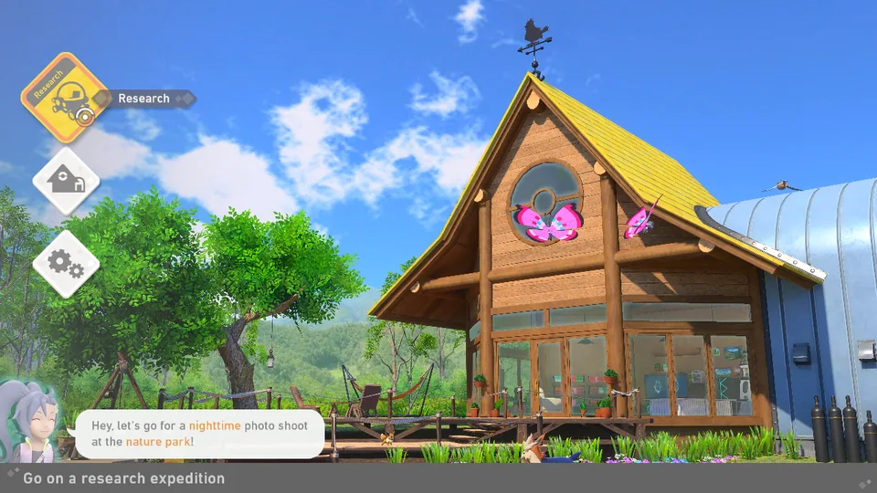
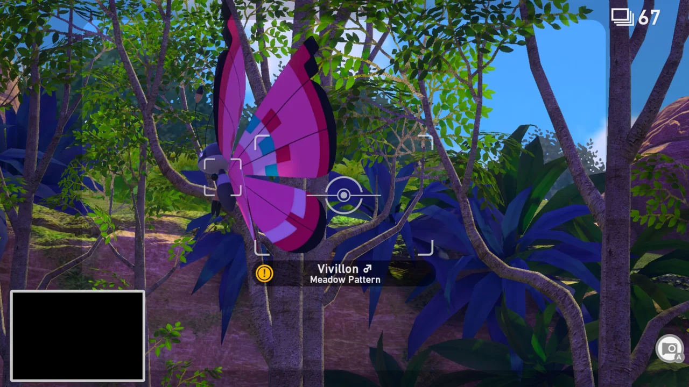

<div align="center">

# New Pokémon Snap PC Recomp

**A native Windows static recompilation of New Pokémon Snap (Switch).**
The game's AArch64 code is lifted to C, built with clang, and run on a hand-written Horizon OS and NVN-to-Vulkan runtime.


</div>

> **This repository contains source code only. It includes no game files, keys, extracted assets or generated game code. You must supply your own legally dumped copy of v2.0.1 (version 262144, title update 2.0.1) of the game.**

## Contents

- [Status](#status)
- [Features](#features)
- [Screenshots](#screenshots)
- [Building](#building)
- [Running and settings](#running-and-settings)
- [Testing](#testing)
- [Project layout](#project-layout)
- [Roadmap](#roadmap)
- [FAQ](#faq)
- [License and credits](#license-and-credits)

## Status

Early playable. The game boots to the title screen, the lab hub and the courses, and photos can be taken, scored, saved and reloaded. Checks so far are scripted runs on a hidden desktop with a null audio backend. No full human play-through has been done.

| Area | State |
| --- | --- |
| Boot, title, lab hub, map | Works |
| Florio Park ride, photo select, scoring | Works. Photos sort by subject, thumbnails show, and the professor scores them |
| Progression | Points registration, save and reload, level 2 unlock (Florio Night) and Photodex persistence pass from a real save. Professor requests were not reached |
| Story | Events 1, 2, 27 and 33 start and play, with cutscenes, dialogue, credits and the post-credits talk. The save after event 2 is verified. The save after credits and events 8 and 35 are not confirmed |
| Secrets | Scan pulses, Level 3 spawns and Night spawns pass. Florio Side Path, Mew, targeted orb, melody and fluffruit reactions, and special-pose photos were not triggered |
| Saves | Written atomically with generations and backups. Every crash stage tested left the old or the new save, never a torn one |
| Audio, video, text | Title, hub, map, Florio ride and photo select have music, shutter and ambience with no clipping. Cutscenes are in-engine, so there are no video files. English text and score numbers read correctly |
| Input | Keyboard, mouse and controllers (XInput, plus SDL3 when built with it). Rumble: the host side works with scripted test values, but no game action was seen producing vibration yet. Gyro was tested only with a scripted route, because no test pad reports a gyro |
| Frame rate | Capped at 60 fps, like the original. A Florio ride held 60.0 fps on an RTX 4090. Frame rate drops when several test instances share one PC; that case has no clean benchmark yet |
| Vulkan validation | Title, hub, one Florio ride and photo select gave no synchronization hazards and no other validation errors after one startup pipeline error was fixed |

Known problems:

- Wurmple photos stay unselectable ("subject is not clearly visible"). The cause is unknown; it may be normal game behavior, since the subject is whatever the reticle center points at.
- A loading hang on Lental was seen once and did not come back in four later runs.
- Draw distance and full-rate distant animation are experimental and may change photo scores.
- A Vulkan warning remains about the BC1 thumbnail encoder drawing a float format into an RGBA16UI stand-in. The spec calls it undefined, but it works on NVIDIA.
- On a 144 Hz display a 60 FPS cadence judders. Present pacing needs VRR or frame-pacing work.
- Rumble in the game itself, evaluation score screen audio, the album viewer, the pause menu and the Sound tab volume were not checked.

## Features

**Look and graphics**

- Default look is original: the game's own FXAA, with no sharpening and no forced anisotropic filtering.
- The enhanced look turns on with one setting (see [Running and settings](#running-and-settings)): 2x supersampling plus SMAA, CAS sharpening, 16x anisotropic filtering, automatic UI font supersampling and PNG photo export (lossless, with a JSON sidecar).
- Quality presets: Very Low, Low, Normal, High, Ultra, Maximum and Custom. Normal leaves the visual defaults alone.
- Upscalers: NVIDIA DLSS and DLAA, AMD FSR and Intel XeSS, each with quality modes. The vendor SDK files are not in this repo. Photos and scoring never use jittered or upscaled output.
- HDR output (HDR10 and scRGB, with fallback to SDR), peak and paper-white settings.
- Render scale from 0.5x to 4x, shadow resolution up to 8192, ambient occlusion options.
- Optional color looks (Neutral, Vivid, Warm, Cool) and per-pass switches for bloom, depth of field, film grain and chromatic aberration.

**Menus and controls**

- Ten PC settings tabs inside the game's own Settings screen: Quality, Textures, Effects, Output, View, Display, Controller, Mouse, Audio and Photos. They use the game's own widgets and its Restore Default Settings. They need a local pack built from your own game files (see [Running and settings](#running-and-settings)).
- An F1 overlay (or hold Back/View + Start on a controller for half a second) with the same options, button remapping, mods and save management.
- Rumble, plus gyro aim on controllers that report a gyro. Gyro drives the right stick because the game never reads motion.
- Keyboard and mouse, including mouse look and click-to-touch.

**Window, saves and tools**

- Borderless fullscreen (F11 or Alt+Enter), monitor choice, remembered window position and size, pause and mute when unfocused, and a fast-boot mode that skips the frame limiter during loading.
- Save profiles with a picker, duplicate, import and restore from trash. Each commit is an immutable generation, and the current and 5 earlier generations are kept as backups.
- One running copy per save folder, so two instances cannot corrupt a save.
- A mod loader for loose-file packs that replace single game archive entries, including HD texture packs. See [docs/mods.md](docs/mods.md). The repo holds only the loader, never pack contents made from game data.
- Options that go beyond the original game: draw distance, detail distance, full-rate distant animation, photos per expedition (72 original, up to 500), NEO-ONE speed and dialogue skipping.

## Screenshots





Both are older captures of the native build running on Windows, scaled to 1280x720.

## Building

You need your own dump of the game. Nothing here downloads it, and no committed script extracts it.

Windows 10 or 11 x64. Local tools go under `tools/`, which is git-ignored, and the scripts look for them at these paths.

| Tool | Path | Used for |
| --- | --- | --- |
| LLVM, clang and lld 23 | `tools/llvm` | Building the lifted C and the host |
| Visual Studio 2022 Build Tools | `C:\Program Files (x86)\Microsoft Visual Studio\2022\BuildTools` | Windows SDK and `vcvars64.bat` |
| Vulkan SDK | `tools/vulkan_sdk` | `vulkan-1.lib`, `glslangValidator` |
| SDL3 (optional) | `tools/dl_sdl3` | Gamepads. XInput is the fallback |
| Python 3 | `tools/venv-recomp` | Lifter and build scripts. Needs `capstone`, `pyelftools`, `numpy`, `lz4` (NSO conversion). `unicorn` for the instruction tests |
| Python 3 | `tools/venv-oodle` | DRP unpacking. Needs `unicorn` for the in-engine Oodle decoder |
| Rust | none | Building the XOR helper: `rustc -O --crate-type cdylib -o tools/oodle_build/drp_xor.dll scripts/drp_xor/drp_xor.rs` |
| NSTool | `tools/nstool` | NCA and RomFS extraction |
| Ghidra 12.1.2 with the Switch loader extension, JDK 21 | `tools/ghidra_*`, `tools/jdk-*` | Function discovery |
| .NET 10 SDK | none | `scripts/shader_harness`, which the host build needs. It references a manually cloned checkout of the Ryubing Ryujinx shader translator at `tools/ref/ryubing-ryujinx` |

`scripts/audit_revisions.py` is the only script that reads `SNAP_DUMPS_DIR` (default `./dumps`): set it to the folder holding your XCI/NSP files and `prod.keys`. NSTool needs `prod.keys` in one of its documented key locations.

Run from the repo root.

1. **Extract.** Use NSTool on the base XCI plus the 2.0.1 update NSP to get the program NCA and the patched RomFS (into `extracted/`). `scripts/pfs0.py` lists and extracts PFS0/NSP members.
2. **Convert modules.** `python -I scripts/nso2elf.py <main.nso> <main.elf>`, then the same for `sdk`.
3. **Unpack archives.**
   ```powershell
   tools\venv-oodle\Scripts\python -I scripts\drp_unpack.py --set priority
   ```
   It is resumable and writes only to `extracted/`.
4. **Discover functions.**
   ```powershell
   scripts\ghidra_import.ps1 -InputFile <main.elf> -Project snap-v262144
   scripts\ghidra_analyze.ps1 -Stage All
   ```
   `-Stage All` runs Analyze, Export and Reconcile. Reconcile writes `functions_final.tsv` and `jump_tables.tsv`, which the lifter needs.
5. **Lift and compile.**
   ```powershell
   tools/venv-recomp/Scripts/python -I recomp/snap_gen.py --module main
   tools/venv-recomp/Scripts/python -I recomp/snap_gen.py --module sdk
   tools/venv-recomp/Scripts/python -I recomp/snap_build.py
   ```
   Generated C goes under `generated/`, which is never committed.
6. **Build the shader harness.**
   ```powershell
   dotnet build scripts/shader_harness/ShaderHarness.csproj -c Release
   ```
   `scripts/xlate_build.ps1` does the same build. The output goes to `tools/shader_harness/bin`, and the host build bakes in the DLL path.
7. **Build the host.**
   ```powershell
   tools/venv-recomp/Scripts/python -I host/build_snap.py
   ```
   `build_snap.py` also runs `host/gen_nvn_bridge.py` and `runtime/hle/gen_hle_stubs.py` to produce the NVN bridge and the unimplemented-function stubs. It produces `build/snap/snap_boot.exe`. A cold host build takes about 90 seconds, and a relink 5 to 10 seconds.
8. **Run.** See the next section.

`AGENTS.md` and `host/README.md` hold the detailed flags and the current state of each step.

## Running and settings

```powershell
powershell -File host\play.ps1                 # normal play, no timeout
powershell -File host\play.ps1 -SkipIntro      # feeds a script through the intro (about 3 to 4 minutes), then hands control back
powershell -File host\play.ps1 -ListPads       # list detected controllers
powershell -File host\run_boot.ps1 -Timeout 100 run   # timed, hidden run with a trace log
```

`play.ps1` also takes `-Profile`, `-PickProfile` and `-NoNativeOptions`. The game window needs one click for focus. Saves are under `%APPDATA%\SnapRecomp\`.

**Native settings tabs.** `play.ps1` builds a local `native-options` pack from your own extracted `option.lmb` before each start (`python -I scripts/ui/make_native_options.py`). The pack is game-derived and is never committed. If the build fails, the PC tabs do not appear. In the game, open the Settings screen from the lab hub gear and press R past the last tab, "Other".

**Environment variables.** A value set by hand always wins over a menu choice and over the look profile.

| Variable | Values | Effect |
| --- | --- | --- |
| `SNAP_PROFILE` | `original` (default), `enhanced` | Switches the five visual defaults together. See `host/README.md` for the table |
| `SNAP_AA` | `original` (default), `fxaa`, `off`, `smaa`, `ssaa2`, joined with `+` or `,` | Anti-aliasing, for example `ssaa2+smaa` |
| `SNAP_RENDER_SCALE` | number | Explicit render scale, never capped |
| `SNAP_SHARPEN` | 0 to 1 | CAS sharpening strength |
| `SNAP_ANISO` | `0` (default, the game's own) or `1` to `16` | Anisotropic filtering |
| `SNAP_UPSCALER` | `off`, `dlss`, `dlaa`, `fsr`, `xess` | Upscaler backend. Falls back through DLSS, FSR and XeSS |
| `SNAP_UPSCALE_QUALITY` | `native`, `quality`, `balanced`, `performance` | Upscaler quality |
| `SNAP_HDR` | `off`, `hdr10`, `scrgb` | HDR output. Peak and paper white (in nits) use `SNAP_HDR_PEAK_NITS` and `SNAP_HDR_PAPER_NITS` |
| `SNAP_PHOTO_EXPORT` | 0, 1 | PNG copies of photos. The folder is `SNAP_PHOTO_DIR` |
| `SNAP_UI_FONT_SCALE` | `off`, `auto`, 1 to 4 | Sharper menu text. `auto` gives 2x at 1440p and above |
| `SNAP_FAST_BOOT` | 1 | Turns the frame limiter off during loading (about 28% faster to the title logo) |
| `SNAP_MODS_DIR` | path | Mod pack folder |
| `SNAP_CONFIG_DIR` | path | Where `input.json` and `window.json` live |

`SNAP_PROFILE` is also read as a save profile name, so any value other than `original` or `enhanced` selects a save profile. To pick a save profile, use `play.ps1 -Profile "<name>"`.

## Testing

- `tests\hle\run_tests.ps1`: HLE host-side tests (build and run).
- `tests\mods\run_tests.ps1`: mod loader tests.
- `tests\os\build.bat`, `tests\audio\build.bat`, `tests\nvn\build.bat`: OS, audio and NVN tests.
- `tests/insn/`: instruction-level differential tests against a Unicorn reference.
- `tests\hle\run_ui_test.ps1`, `run_options_test.ps1`, `run_profiles_test.ps1`, `run_switch_test.ps1`: tests that boot the game.

Game-level checks use scripted routes: `powershell -File host\run_boot.ps1 -Route <name>` feeds `host\routes\<name>.txt` as input and saves checkpoint screenshots. Scripts can wait on game state with `wait <condition>` and `end` lines (conditions such as `ui=<scene>`, `dialog`, `ride`, `ride_end` and `film<=<n>`), so a route does not depend on fixed timing. A timeout exits with code 3 and logs the UI state. Up to 4 hidden runs at a time. See `host/README.md` for details.

## Project layout

| Path | Contents |
| --- | --- |
| `recomp/` | Python lifter and C emitter. Reads the game's `main` and `sdk` modules as ELF files and writes C, one function per guest function |
| `runtime/` | Guest CPU model and SIMD helpers, Horizon OS layer (`os/`), HLE services (`hle/`), audio (`audio/`, WASAPI), NVN-to-Vulkan graphics (`nvn/`), mod loader (`mods/`) |
| `host/` | Loader, boot driver, `build_snap.py`, `play.ps1`, `run_boot.ps1`, scripted routes and in-game mods |
| `scripts/` | Extraction, unpacking and analysis tools: NSO to ELF, PFS0, DRP archives, shader and format parsers, Ghidra scripts, an offline Maxwell-to-SPIR-V harness |
| `tests/` | Instruction differential, HLE, mods, audio, NVN and OS tests |
| `docs/` | Design notes, `mods.md` and screenshots |
| `AGENTS.md` | The project's decisions and current state |

Game shaders are translated offline (Ryujinx shader translator to SPIR-V) and loaded at run time from your own extracted files. Nothing derived from the game is stored in the repo.

## Roadmap

Unpushed work in progress: save hardening and the profile changes it needs; load-time and scheduler fixes; NVN object lifetime fixes and audits.

Planned:

- Wider scripted course coverage.
- A human play-through. Professor requests, the album viewer and several secrets are unchecked.
- The cause of the Wurmple photo problem.
- Present pacing for high-refresh displays.

## FAQ

**Is this an emulator?**
No. The game's code is translated ahead of time into C and compiled into a Windows executable. The Switch OS and GPU interfaces are re-implemented natively (Horizon OS services, and NVN on top of Vulkan). There is no CPU emulation loop at run time.

**Where are the game files?**
The repo has no game files, so you dump your own copy of v2.0.1 and run the pipeline above. Generated code, extracted assets, keys and vendor SDK binaries are git-ignored and must never be committed or shared.

**Does it change photo scoring?**
Not by default. The defaults aim for the original look and behavior. Photos and scoring never use jittered or upscaled output. The View options (draw distance, detail distance, full-rate animation) can change which Pokémon are in a photo and so the score, which is why they are marked experimental.

**Why does the first launch build something with my game files?**
The native settings tabs are patched into a copy of the game's own settings UI file, built on your PC. That file is never committed.

## License and credits

MIT, see [LICENSE](LICENSE). The lifter and CPU runtime adapt TotK Recomp and LAS Recomp (both MIT); the shader harness builds on the Ryujinx shader translator; the SSBH layout follows ssbh_lib. Full notices are in [THIRD_PARTY_NOTICES.md](THIRD_PARTY_NOTICES.md).

New Pokémon Snap is a trademark of Nintendo and The Pokémon Company. This project is unaffiliated with them.
